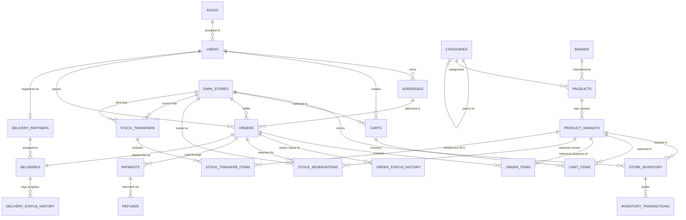

# QuickKart — Entity-Relationship (ER) Model

This document outlines the complete Entity-Relationship diagram for the **QuickKart Quick-Commerce Management System**.

## Mermaid ER Diagram

## Domain Partitioning

| Domain | Entity Count | Core Tables |
| :--- | :--- | :--- |
| **A. Identity & Access** | 3 | `roles`, `users`, `addresses` |
| **B. Product Catalogue** | 4 | `categories`, `brands`, `products`, `product_variants` |
| **C. Dark Stores & Inventory** | 3 | `dark_stores`, `store_inventory`, `inventory_transactions` |
| **D. Carts & Orders** | 5 | `carts`, `cart_items`, `orders`, `order_items`, `order_status_history` |
| **E. Stock Reservations** | 1 | `stock_reservations` |
| **F. Payments & Refunds** | 2 | `payments`, `refunds` |
| **G. Delivery Management** | 3 | `delivery_partners`, `deliveries`, `delivery_status_history` |
| **H. Stock Transfers** | 2 | `stock_transfers`, `stock_transfer_items` |
| **Total** | **23 Tables** | Complete 3NF Normalized System |
